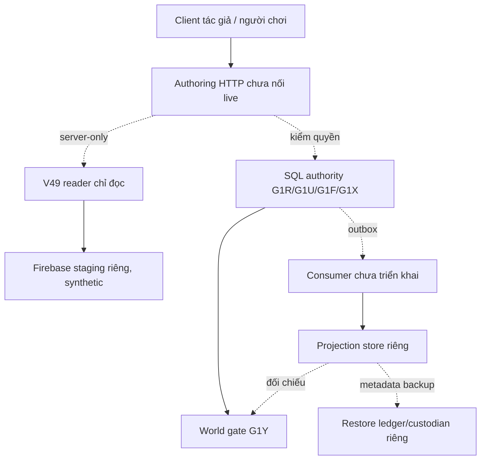

# G2J — Thiết kế ranh giới Firebase staging và ma trận quyền dịch vụ

27/10/2026. Nền `main` G2I `100d670`. G2I đã tổng kiểm toán G1R–G2H và trả 7 blocker. G2J chỉ bổ sung **ADR đề xuất, ma trận phân quyền và trình kiểm tra bản khai offline**; không bật host, tạo Firebase project/database, hỏi credential, gọi Firebase CLI, tạo service account, chỉnh IAM/Rules, sửa cấu hình deploy hay kết nối Worker. **Chưa phải bản thiết kế schema cho một edition Firestore cụ thể:** phải biết instance/edition thật trước khi thiết kế query/index/Rules và viết SDK host.

## 1. Bằng chứng mã nguồn đã kiểm tra

| Thành phần | Hiện trạng quan sát | Điều không thể suy ra |
| --- | --- | --- |
| `firebase.json` | Chỉ cấu hình `functions` | Không chứng minh có khai báo/triển khai Firestore Rules từ repository này |
| `security/firestore-epub-v49.rules.review` | Snippet V49 có cảnh báo phải merge vào Rules đang chạy sau khi backup | **Không** là Rules đã deploy; không được chép đè, đổi quyền V49 độc giả hoặc dùng làm IAM cho SDK server |
| `docs/DUDU-V49-PRODUCTION-EPUB.md` | Mô tả V49 đang hoạt động ở giao diện dành cho admin nhập và độc giả đọc truyện published | Không xác nhận trạng thái Firebase Console/Auth/Rules thực tế ngày 27/10/2026 |
| `cloudflare/src/vangioi-v49-firestore-reader.mjs` | G1T đọc `epub_stories_v49` và chapters qua một read-only transaction do host cấp | Không tự tạo Admin SDK/credential và không bảo đảm đã chọn đúng Firestore database thật |
| `cloudflare/src/vangioi-fixture-staging-integration-audit.mjs` | G2I kiểm nhất quán G2B/G2A/G1Y fixture | Không có giao dịch Firestore–SQLite, service IAM hay token phát hành |

**Ranh giới quan trọng:** Firestore server SDK/Admin SDK **không chịu ràng buộc bởi Firestore Security Rules dành cho ứng dụng client**; truy cập máy chủ được kiểm bằng IAM. Vì vậy cả **IAM/quyền service** lẫn **allowlist đường đọc, kiểm operator và kiểm quyền ở lớp ứng dụng** phải được đánh giá độc lập. Xem [Firebase — Security Rules conditions](https://firebase.google.com/docs/firestore/security/rules-conditions), [Firebase — IAM và quản lý database](https://firebase.google.com/docs/firestore/manage-databases). Firebase cũng [khuyến nghị tách project theo môi trường](https://firebase.google.com/docs/projects/dev-workflows/overview-environments).

## 2. Topology đề xuất, CHƯA ĐƯỢC DU DUYỆT

- Firebase staging phải là **project riêng**, chỉ chứa bản dữ liệu **synthetic**. Không trỏ staging reader vào production V49 hay copy dữ liệu người dùng/EPUB thật để tiện thử. Project ID, database ID, edition và location **hiện chưa chọn**; không tự đặt giá trị mặc định. Nếu đã có instance, xác định edition trước theo hồ sơ Firebase được Du chấp thuận.
- SQL authority duy nhất trong staging giữ permit G1R, outbox G1U, registry/snapshot/grant/world và notice G1X theo hợp đồng nguyên tử hiện hành. Projection/consumer và sổ restore độc lập, **không được diễn giải thành transaction xuyên kho**.
- Read-only transaction V49 thuộc host tin cậy, được giới hạn collection/định danh/chiều dài/nội dung theo G1T/G1S, không trả chapter/proof/ownerUid vào diagnostics. Dữ liệu nguồn và permit là hai authority khác nhau; không có quyền nào suy ra từ `published`, `ownerUid` hay `admin:true` bên client.
- Mọi lựa chọn quyền/cửa phát hành vẫn do server recheck G1Y ở từng ranh giới thực. G2I PASS chỉ hỗ trợ đánh giá fixture. Tác giả không tự cấp permit/grant/XP/Xu/Kho; reviewer cũng không tự mang quyền operator/publisher.
- Không điều chỉnh cách đọc công khai các EPUB V49 đang có; đây là thiết kế cho **đường chuyển thể Vạn Giới tương lai**, không phải một đợt thay thế hệ thống Thư viện hay Rules hiện hành.

## 3. Ma trận quyền tối thiểu — đề xuất, chưa áp dụng IAM

| Principal / danh tính | Được phép trong thiết kế staging | Bắt buộc từ chối hoặc tách rời | Cơ chế kiểm (dự kiến) |
| --- | --- | --- | --- |
| Tác giả Vạn Giới (browser) | Soạn nháp local, khai báo arc và nguồn đề xuất | Đọc EPUB private qua authoring, tự ghi permit/source grant, quyết định publish, XP/Xu/Kho | Firebase Auth chỉ là danh tính; service kiểm entitlement/scope server-side |
| Reviewer (browser) | Xem snapshot được server cấp đúng scope theo G1L/G1K khi được nối | Trực tiếp issue/revoke permit, ghi Firestore, duyệt qua client claim giả | Membership + reviewer assignment trong authority, không là operator mặc định |
| Độc giả V49 (browser) | Tiếp tục đường đọc published của V49 theo Rules đã được phê duyệt hiện hành | Đọc draft/private hoặc coi published là giấy phép chuyển thể | Rules client của hệ V49 hiện hành; G2J **không sửa Rules** |
| `v49-reader-host` | Server chỉ đọc book/chapters của project staging allowlist | Ghi V49, đọc bừa project production, cấp permit | Service identity/least privilege IAM và đường dẫn G1T allowlist, kiểm scope host |
| `permit-authority-host` | G1R issue/revoke theo operator active, append G1U; kiểm revision | Cho role từ client, copy claim admin sang quyền cấp phép, ghi V49 | Server JWT verification + assignment SQL; atomic transaction authority |
| `outbox-projection-consumer` | Đọc outbox, cập nhật projection/event/checkpoint staging có CAS | Sửa permit source-of-truth, đồng bộ cấp quyền ngược, dùng client token | Service-to-service, replay idempotent, revoked-wins và G2B đối soát |
| `restore-custodian` | Đọc backup đã ký, reserve nonce, audit target/replay theo quy trình | Xóa nonce, hồi phục đè dữ liệu đang dùng, cấp world release, tự đổi khóa | Identity riêng, ký/KMS, guard, custody, operator reconciliation |
| `world-rights-gate` | G1Y kiểm snapshot/grant/permit/notice/assets hiện hành | Tin projection `active` như permit source-of-truth, tự tạo session/reward | Chỉ server, recheck tại release/start/resume/read trong thiết kế tương lai |
| Chủ dự án An Du | Duyệt policy/đợt triển khai và giao nhiệm vụ operator phía hệ tin cậy | Không biến nút bấm client thành service credential hoặc migration tự chạy | Biên bản quyết định riêng + audit trail/rollback |

Các danh tính dịch vụ trên là **nhãn trách nhiệm**, chưa phải Google service account, Firebase custom claim, IAM role hay quyền đã được cấp. Cần threat-model cụ thể trước khi ánh xạ sang IAM. Không đặt secret vào GitHub, tài liệu hoặc fixture.

## 4. Trình kiểm tra bản khai offline G2J

`cloudflare/src/vangioi-staging-connection-plan.mjs` cung cấp:

- `STAGING_SERVICE_BOUNDARIES`: sáu vai trò ranh giới đề xuất; **chỉ là dữ liệu tài liệu**.
- `STAGING_CONNECTION_PLAN_TEMPLATE`: bản khai có `firebase.projectId/databaseId/edition/location = null` để thể hiện **chưa có quyết định**. Các trường ranh giới được cố định: `environment:'staging'`, `isolation:'separate-project-synthetic-only'`, `sourceCollection:'epub_stories_v49'`, `reader:'server-read-only'`, `permit:'sql-operator-only'`, `consumer:'server-outbox-only'`, `recovery:'separate-custodian'`, `author:'no-adaptation-rights'`, `world:'current-authority-recheck'`.
- `reviewStagingConnectionPlan(plan)`: kiểm **hình dạng/ý định** của bản khai, từ chối production, cấu trúc lạ chứa secrets/credential/client quyền nâng cấp, ghi V49 hoặc sai collection. Null được báo `planning-decisions-pending`; một bản khai synthetic điền đủ trường trả `plan-declared-not-verified`.
- Kết quả hợp lệ **luôn trả** `firebaseConnectionEstablished:false`, `permissionsVerified:false`, `stagingDeploymentAuthorized:false`, `releaseAuthorized:false`, danh sách `requiredEvidence`. Công cụ **không kiểm tra Firebase thực**, IAM thật, edition thực, sự tồn tại database, khả năng truy cập hay việc staging thật đã cách ly. Không dùng `ok:true` làm deploy gate, chạy CI làm bằng chứng hợp pháp hoặc thay quyền Du.

## 5. Rủi ro phải giải quyết trước khi cho phép staging thực

| Kịch bản lỗi/tấn công | Biện pháp bắt buộc trước khi bật |
| --- | --- |
| Server Admin SDK bypass Rules | IAM đúng service identity, tránh wildcard dự án/tenant, allowlist đường đọc và log không lộ chương private |
| Accidentally chọn Firebase production | Project staging riêng, kiểm danh tính project/database/edition/location bằng host và bên vận hành, test âm tính cross-project |
| Browser giả `admin`, `ownerUid` hoặc `permit` | Server xác minh token và operator assignment riêng; client không cung cấp callback/credential/quyền issuer |
| Book V49 sửa/gỡ sau khi hash pin | Chính sách hash immutable/version fence, quy trình notice/revoke/tạm giữ ngoài SQL, recheck tại commit và lúc dùng |
| SQL outbox replica stale hoặc thiếu key | Consumer durable + CAS atomic per store, G2A/G2B/G1Y bắt buộc, giới hạn/pagination và cảnh báo lag |
| Restore bản sao stale, clone target/nonce sau crash | KMS/custody thật, ledger chung bền vững, anti-clone/target attestation, reconcile receipt + audit authority và runbook rollback |
| Audit PASS bị hiểu là quyền phát world | Không có code path chuyển G2I/G2J PASS thành creator/publisher/reward; gate tại từng thời điểm sử dụng |

## 6. Quyết định cần chủ dự án chọn trong tương lai

1. Firebase project staging riêng và database đang có hay cần mới; **edition Standard/Enterprise và location** theo inventory chính thức. Chưa tự chọn edition/region dựa vào tài khoản đang đăng nhập.
2. Nguồn nào có quyền xác nhận chuyển thể, khi chủ truyện đổi/gỡ/unpublish thì world dùng bản pin cũ đến đâu, thời điểm và mức độ block.
3. Ai là operator được giao phía backend và service custodian; định nghĩa least privilege cùng cơ chế lưu/luân phiên khóa, audit và thông báo sự cố.
4. Chi phí/retention, max lag, backup/restore, chính sách dùng dữ liệu synthetic và kịch bản rollback staging.
5. Duyệt riêng từng mốc: tạo môi trường staging → kết nối read-only → consumer/revoke → author source picker/review → release. Không gộp làm một thao tác.

**G2K gợi ý:** xây bộ diễn tập fail-closed **Emulator-only** cho ranh giới danh tính service và đường đọc V49 trên `demo-*`, không cần hoặc đụng Firebase Console thật; muốn nối staging thật vẫn phải qua các quyết định trên.

## 7. QA, phạm vi và rollback

- Unit test bản khai chưa chọn, bản khai synthetic được chọn nhưng không có quyền deploy, thông tin nhập sai/giả môi trường, credential nhét vào JSON, thay role, project/region/edition không hợp lệ và kiểm source không bị import vào Worker/HTTP.
- Chạy hồi quy Worker, app, Functions và Cloudflare dry-run. Đây **không phải Firebase Emulator smoke hay staging smoke thật**.
- Không thay đổi `firebase.json`, `.firebaserc`, Firestore Rules, security review snippets, backend/DO host, tài khoản, EPUB V49, Canon hoặc game reward. Không tự cấp quyền tác giả/reviewer/publisher từ client, bật 48 seed, XP/Xu/Kho, NPC AI hay production.
- Rollback: revert module, test, contract và link README. Không có migration, dữ liệu user, secret, IAM/service account, Rules hay staging resource nào được tạo.
